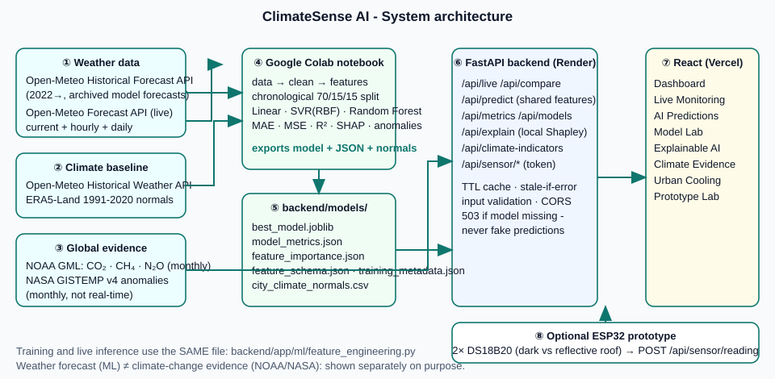

# ClimateSense AI - Live Urban Heat-Island Monitoring, Climate Intelligence and ML-Based Temperature Prediction

**Course:** Global Warming and Climate Change · **Topic:** Urban Heat-Island Reduction · **Date:** {{DATE}}
**Team / Roll numbers:** _[fill in]_ · **GitHub:** _[link]_ · **Website:** _[link]_ · **Colab:** _[link]_

## 1. Problem statement
Cities are warmer than surrounding areas (urban heat island, UHI) because dark, impervious surfaces absorb heat, vegetation is scarce and waste heat is released. Heat stress threatens health, productivity and energy systems, yet local officials need *understandable* short-range heat information together with context about long-term climate change. The project builds a live, explainable machine-learning platform that forecasts the next-day maximum temperature of six Indian cities, places it against a 1991-2020 climate baseline and links it to global climate evidence and urban-cooling measures.

## 2. Climate-change relevance
Global temperatures and greenhouse-gas concentrations have risen since the pre-industrial period (NASA GISTEMP, NOAA GML). Warming increases the likelihood of heat extremes, and urban areas amplify exposure. The project keeps two ideas separate: **weather forecasting** (days, a statistical ML task) and **climate-change analysis** (decades, shown through NOAA/NASA data). The daily regression model does **not** prove greenhouse-gas causation.

## 3. Aim and objectives
Aim: build a working, publicly accessible, explainable ML application for urban heat awareness. Objectives: (1) monitor live weather; (2) predict next-day Tmax with Linear Regression, SVR and Random Forest; (3) compute anomalies against 1991-2020 normals and project-defined heat categories; (4) monitor CO₂, CH₄, N₂O and NASA temperature anomalies; (5) explain predictions; (6) recommend urban cooling strategies; (7) optionally demonstrate roof-albedo cooling with an ESP32 model.

## 4. Relevant syllabus units
_[Map to your syllabus: e.g. greenhouse effect & global warming; observed climate change evidence; climate data and modelling; impacts and urban heat; mitigation & adaptation; ML for climate applications.]_

## 5. Data sources
Open-Meteo Forecast API (live); Open-Meteo Historical Forecast API (archived model forecasts, training); Open-Meteo Historical Weather API with ERA5-Land (1991-2020 normals, ≈0.1°); NOAA GML global monthly CO₂/CH₄/N₂O; NASA GISS GISTEMP v4. Training data: {{CITIES}}; period {{PERIOD}}; downloaded {{RETRIEVED}}; {{ROWS}} city-day rows. Values are model-derived, not station readings.

## 6. System architecture

Colab notebook → exported model/JSON/normals → FastAPI (Render) → React dashboard (Vercel); optional ESP32 → sensor endpoint. Training and live inference share one feature-engineering module.

## 7. Methodology
Hourly data are aggregated to local days. Features (cutoff day D): max/min temperature (D, D-1, D-2), humidity, rain, wind, solar radiation, pressure, cloud cover, 3- and 7-day mean Tmax, day-of-year sine/cosine, latitude, longitude. Target: Tmax of D+1. Chronological split by unique dates - {{SPLIT}} - with a 1-day gap; time-aware cross-validation and grid search only on the training period; imputers/scalers fitted inside pipelines. Best model = lowest validation MAE; the test set is used once afterwards. Anomaly = prediction − 1991-2020 seasonal normal (±7-day window); categories Normal / Elevated / High / Severe from +1.5 °C and the 90th/95th percentiles (project-defined, **not IMD warnings**).

## 8. Algorithms
**Linear Regression** - weighted sum of scaled features. **SVR (RBF)** - fits a smooth non-linear curve inside an ε-tube, controlled by C, ε, γ. **Random Forest** - average of many decision trees. **Persistence** - tomorrow = today (baseline). Explainability: RF importance, permutation importance, SHAP.

## 9. Evaluation metrics
MAE = mean(|y − ŷ|) (°C); MSE = mean((y − ŷ)²) (°C²); R² = 1 − SS_res/SS_tot.

## 10. Actual results (from the notebook run)
| Model | Val MAE | Val MSE | Val R² | Test MAE | Test MSE | Test R² |
|---|---|---|---|---|---|---|
{{TABLE}}

Selected model: **{{BEST}}**.

## 11. Observations (computed from the results)
{{OBS}}

## 12. Prototype observations
{{PROTO}}

## 13. Environmental benefit
Short-range heat awareness supports timely protective action; the explanations make forecasts auditable; the cooling guide (cool/green roofs, trees, shade, planning) targets the causes of the heat island and lowers cooling energy demand. The optional model makes the albedo effect tangible.

## 14. Limitations
About four years of model-derived data; six cities; no station validation; heat categories are project-defined; ERA5-Land vs forecast-archive product offset (corrected by a per-city mean shift); a weather model cannot attribute warming to greenhouse gases; NOAA/NASA series are monthly and lag by weeks; free API tiers have rate limits.

## 15. Conclusion
The project delivers a reproducible, explainable ML application that is honest about data provenance and uncertainty and connects local heat forecasting with global climate evidence and practical urban-cooling action.

## 16. References
- Open-Meteo.com - Weather Forecast, Historical Forecast and Historical Weather APIs (CC BY 4.0). https://open-meteo.com/en/docs
- Hersbach, H. et al. (2020). The ERA5 global reanalysis. *Q. J. R. Meteorol. Soc.* 146, 1999-2049.
- Muñoz-Sabater, J. et al. (2021). ERA5-Land: a state-of-the-art global reanalysis dataset for land applications. *Earth Syst. Sci. Data* 13, 4349-4383.
- NOAA Global Monitoring Laboratory - Trends in CO₂, CH₄, N₂O. https://gml.noaa.gov/ccgg/trends/
- GISTEMP Team: NASA GISS Surface Temperature Analysis (GISTEMP v4); Lenssen, N. et al. (2019), *J. Geophys. Res. Atmos.* 124.
- Pedregosa, F. et al. (2011). Scikit-learn: Machine learning in Python. *JMLR* 12, 2825-2830.
- Lundberg, S. & Lee, S.-I. (2017). A unified approach to interpreting model predictions (SHAP). *NeurIPS*.
- IPCC (2021, 2022). Sixth Assessment Report, WGI and WGII. https://www.ipcc.ch/assessment-report/ar6/
- US EPA. Heat Island Effect. https://www.epa.gov/heatislands
